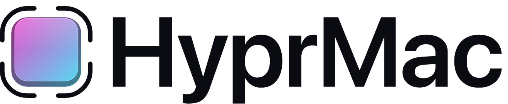
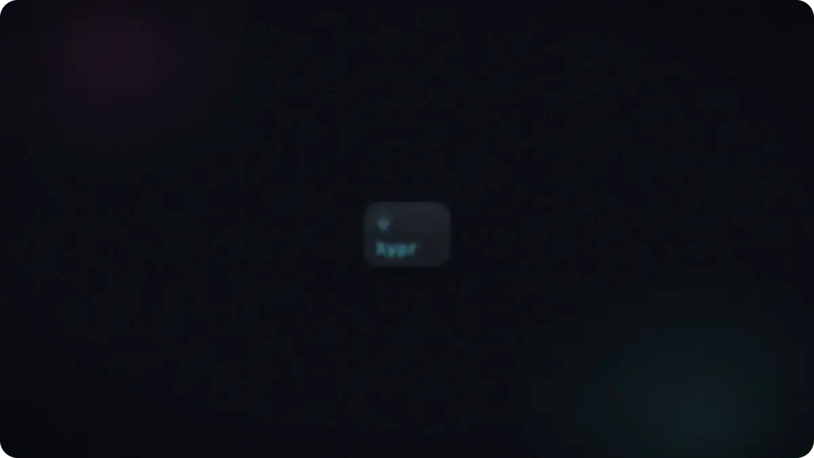
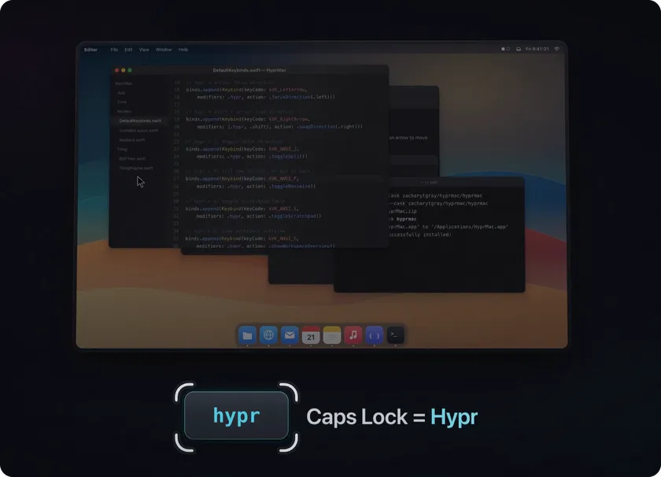
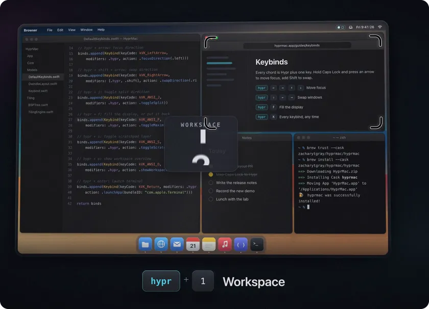
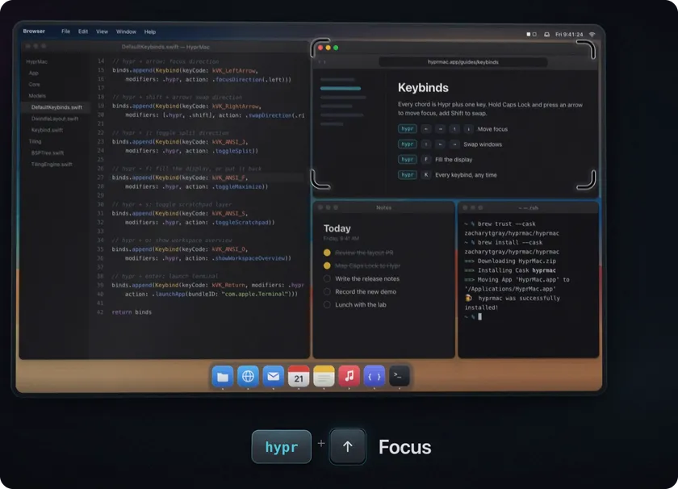
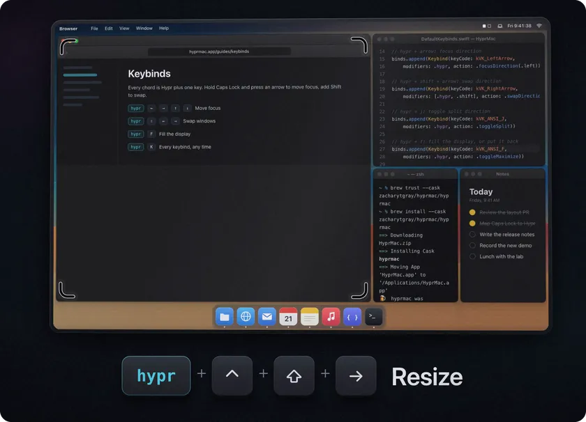

<div align="center">

<picture>
  <source media="(prefers-color-scheme: dark)" srcset="docs/readme/logo-dark.png">
  <source media="(prefers-color-scheme: light)" srcset="docs/readme/logo-light.png">
  
</picture>

### Tile your Mac from the keyboard.

A keyboard-driven tiling window manager for macOS, inspired by [Hyprland](https://hyprland.org).<br>
Free, open source, and the first real job your Caps Lock key has ever had.

[![Latest release][badge-release]][releases]
[![Downloads][badge-downloads]][releases]
[![Stars][badge-stars]][stargazers]
[![macOS 13 or later][badge-macos]](#install)
[![MIT license][badge-license]](LICENSE)

**[<kbd> <br> Install <br> </kbd>](#install)**&nbsp;
**[<kbd> <br> Features <br> </kbd>](#what-it-does)**&nbsp;
**[<kbd> <br> Keys <br> </kbd>](#the-five-keys-to-know)**&nbsp;
**[<kbd> <br> Docs <br> </kbd>](#docs)**&nbsp;
**[<kbd> <br> hyprmac.app <br> </kbd>][site]**

<a href="https://hyprmac.app/hyprmac-showreel.mp4">
  
</a>

**[▶ Watch the one-minute demo][demo]** &nbsp;·&nbsp; **[Try it in your browser][try]** &nbsp;·&nbsp; **[Download for macOS][dmg]**

</div>

## What it does

If your Mac usually looks like a pile of windows stacked on top of each other, and the one you
want is always at the bottom, HyprMac is for you. Hold one key, tap another, and the desktop
does what you asked.

<table>
  <tr>
    <td width="50%" valign="top">
      
      <h3>Windows arrange themselves</h3>
      <p>Open an app and it slots into a tidy tiled layout. No dragging, no resizing, no digging.</p>
    </td>
    <td width="50%" valign="top">
      
      <h3>Your keyboard drives</h3>
      <p><kbd>Hypr</kbd> + an arrow moves between windows. Add <kbd>Shift</kbd> to swap them.
      <kbd>Hypr</kbd> + <kbd>J</kbd> flips a split.</p>
    </td>
  </tr>
  <tr>
    <td width="50%" valign="top">
      
      <h3>Ten workspaces</h3>
      <p><kbd>Hypr</kbd> + a number jumps to a workspace. Add <kbd>Shift</kbd> to send the
      focused window there.</p>
    </td>
    <td width="50%" valign="top">
      
      <h3>A scratchpad one key away</h3>
      <p>Keep music or notes on a floating layer. <kbd>Hypr</kbd> + <kbd>S</kbd> brings it up
      and puts it away.</p>
    </td>
  </tr>
</table>

<div align="center">
<table>
  <tr>
    <td align="center" valign="top"><h3>10</h3>workspaces</td>
    <td align="center" valign="top"><h3>60+</h3>default shortcuts,<br>all remappable</td>
    <td align="center" valign="top"><h3>14</h3>choices for<br>the Hypr key</td>
    <td align="center" valign="top"><h3>1,900+</h3>unit tests</td>
    <td align="center" valign="top"><h3>60+</h3>releases since<br>April 2026</td>
  </tr>
</table>
</div>

## The five keys to know

The Hypr key is Caps Lock out of the box. Hold it like a modifier.

| Keys | What happens |
|------|--------------|
| <kbd>Hypr</kbd> + <kbd>←</kbd> <kbd>→</kbd> <kbd>↑</kbd> <kbd>↓</kbd> | Move between windows |
| <kbd>Hypr</kbd> + <kbd>Shift</kbd> + <kbd>←</kbd> <kbd>→</kbd> <kbd>↑</kbd> <kbd>↓</kbd> | Swap windows around |
| <kbd>Hypr</kbd> + <kbd>1</kbd>–<kbd>9</kbd>, <kbd>0</kbd> | Jump to workspace 1–9, or 10 |
| <kbd>Hypr</kbd> + <kbd>Return</kbd> | Open Terminal |
| <kbd>Hypr</kbd> + <kbd>K</kbd> | Show every keybind |

Most people have these down in a few minutes. Forgot one? <kbd>Hypr</kbd> + <kbd>K</kbd> lists
every shortcut, and you can type to filter it. When you want more, every keybind is remappable
and you can point keys at your own scripts.

## Install

```sh
brew trust --cask zacharytgray/hyprmac/hyprmac
brew install --cask zacharytgray/hyprmac/hyprmac
```

Homebrew refuses to load casks from third-party taps until you trust them. The first line trusts
only the HyprMac cask, which also lets `brew upgrade --cask hyprmac` work later.

No Homebrew? Download **[HyprMac.dmg][dmg]**, open it, and drag HyprMac to Applications. Older
versions are on the [releases page][releases].

Then follow the [install guide](https://hyprmac.app/guides/install/) for first-run setup,
permissions, and the recommended macOS settings. A short tour on first launch walks you through
the keys.

**Requirements**

- macOS 13 (Ventura) or later, on Apple silicon or Intel.
- Accessibility permission, in System Settings → Privacy & Security → Accessibility.
- Nothing else. System Integrity Protection stays on.

> [!IMPORTANT]
> With Caps Lock as your Hypr key, leave Caps Lock set to **"⇪ Caps Lock"** in System Settings →
> Keyboard → Keyboard Shortcuts → Modifier Keys. Do not set it to "No Action". The pane is per
> keyboard, so check each one you use. HyprMac remaps Caps Lock to F18 itself.

<details>
<summary><b>Choosing a different Hypr key</b></summary>
<br>

Settings → Keys offers 14 choices: Caps Lock, backslash, F13–F20, and Option or Command on
either side.

- If Option or Command is your Hypr key, leave it on its default in the Modifier Keys pane too.
  Backslash and F13–F20 are not in that pane and need nothing.
- If you pick the left Option or Command key, that key plus a key HyprMac uses goes to HyprMac.
  Type shortcuts like ⌘S or ⌘T with the right-hand key.
- Shift and Control are not offered because many default shortcuts add them to Hypr. Tab and
  backtick are not offered because Hypr+Tab, Hypr+Shift+Tab, and Hypr+` are default shortcuts.
  A config that already uses one of these keys keeps working, and Settings → Keys says why it is
  no longer recommended.
- macOS gives apps no way to read the Modifier Keys setting, so HyprMac shows a reminder in
  onboarding and in Settings → Keys, with an Open Keyboard Settings button.

</details>

## More than tiling

<table>
  <tr>
    <td width="33%" valign="top">
      <b>Focus you can see</b><br>
      Inactive windows dim. Corner brackets mark the focused window while you hold Hypr, and
      they glide to the next one when focus moves.
    </td>
    <td width="33%" valign="top">
      <b>Drag with a preview</b><br>
      Drag a window onto a tile's edge to insert it there. Hold Hypr while dragging to swap.
      A highlight shows where it will land.
    </td>
    <td width="33%" valign="top">
      <b>Every monitor</b><br>
      Each workspace has a home monitor. <kbd>Hypr</kbd> + <kbd>Ctrl</kbd> + an arrow sends
      a window to the next display.
    </td>
  </tr>
  <tr>
    <td valign="top">
      <b>Overview</b><br>
      <kbd>Hypr</kbd> + <kbd>O</kbd> shows every workspace and what is on it. Name your
      workspaces and the names show up there.
    </td>
    <td valign="top">
      <b>Maximize and float</b><br>
      <kbd>Hypr</kbd> + <kbd>F</kbd> fills the display and puts the window back.
      <kbd>Hypr</kbd> + <kbd>T</kbd> floats a window above the tiles.
    </td>
    <td valign="top">
      <b>Pin apps</b><br>
      Send an app to the same workspace every time it opens, or to the scratchpad. Keep
      other apps out of tiling entirely.
    </td>
  </tr>
  <tr>
    <td valign="top">
      <b>Saved layouts</b><br>
      Save a layout for the displays you have connected. HyprMac restores it when you
      plug the same displays back in.
    </td>
    <td valign="top">
      <b>Settings, not dotfiles</b><br>
      Gaps, focus look, keybinds and the Hypr key all live in a Settings window. The same
      settings are plain JSON on disk if you want them.
    </td>
    <td valign="top">
      <b>Your own tools</b><br>
      Bind a key to any script. Drive HyprMac from Raycast or BetterTouchTool with
      <code>hyprmac://</code> links. Feed sketchybar from <code>state.json</code>.
    </td>
  </tr>
</table>

HyprMac is a signed and notarized universal app. It updates itself through Sparkle.

## For Hyprland folks

You'll feel at home. The differences are mostly macOS being macOS.

| In Hyprland | In HyprMac |
|-------------|------------|
| Dwindle&nbsp;layout | BSP dwindle. New windows split the focused one, and <kbd>Hypr</kbd> + <kbd>J</kbd> flips the split direction. |
| Workspaces | Ten virtual workspaces on keys 1–9 and 0. macOS has no public API for this, so HyprMac keeps its own and hides the other workspaces' windows when you switch. |
| Special&nbsp;workspace | The scratchpad, on <kbd>Hypr</kbd> + <kbd>S</kbd>. |
| Fullscreen | <kbd>Hypr</kbd> + <kbd>F</kbd> fills the display over the workspace. Native macOS fullscreen spawns its own Space and wrecks the layout, so HyprMac does not use it. |
| `follow_mouse` | Focus follows mouse, on by default, with an adjustable hover rate. |
| `SUPER` | The Hypr key. Caps Lock by default. |
| `hyprland.conf` | Settings, saved as JSON at `~/Library/Application Support/HyprMac/config.json`. The schema is in [Keybinds and actions](docs/keybinds-and-actions.md). |
| `exec`&nbsp;binds | Settings → Keys → Add → Command… binds a chord to any program or script. It runs directly, not through a shell, so keep pipes and redirects inside a script. |
| `hyprctl`&nbsp;`dispatch` | [`hyprmac://action/…` links](docs/external-control.md), once you turn on "Allow other apps to control HyprMac". |

Dragging works too. Drag a tiled window by its title bar onto another tile's edge to insert it
there, or hold Hypr while dragging to swap the two. The tile can be on another monitor, and an
empty workspace there takes the window whole.

## Reference

<details>
<summary><b>All default keybinds</b></summary>
<br>

Everything below is configurable in Settings → Keys. The full reference lives at
[hyprmac.app/guides/keybinds](https://hyprmac.app/guides/keybinds/).

| Shortcut | Action |
|----------|--------|
| `Hypr + ←/→/↑/↓` | Focus window in direction |
| `Hypr + Shift + ←/→/↑/↓` | Swap window in direction |
| `Hypr + Ctrl + ←/→/↑/↓` | Move window to the adjacent monitor in that direction |
| `Hypr + Ctrl + Shift + ←/→/↑/↓` | Resize focused window in direction |
| `Hypr + 1–9` / `Hypr + 0` | Switch to workspace 1–9 / workspace 10 |
| `Hypr + Shift + 1–9` / `Hypr + Shift + 0` | Move window to workspace 1–9 / workspace 10 |
| `Hypr + Ctrl + Shift + 1–9` / `Hypr + Ctrl + Shift + 0` | Move window to workspace 1–9 / 10 and switch there with it |
| `Hypr + Tab` / `Hypr + Shift + Tab` | Cycle occupied workspaces on this monitor |
| `Hypr + F` | Maximize the window, or put it back |
| `Hypr + T` | Toggle floating and tiled |
| `Hypr + Shift + T` | Cycle focus through floating windows |
| `Hypr + J` | Toggle split direction |
| `Hypr + S` / `Hypr + Shift + S` | Toggle scratchpad / send window to scratchpad |
| `Hypr + W` | Close window |
| `Hypr + P` | Pause or resume tiling |
| `Hypr + K` | Show the keybind overlay |
| `Hypr + O` | Show workspace overview |
| `Hypr + Ctrl + S` / `Hypr + Ctrl + R` | Save / restore the layout for this display setup |
| `Hypr + R` | Retile all spaces (also applies workspace pins) |
| `Hypr + Return` | Launch or focus Terminal |
| ``Hypr + ` `` | Warp the cursor to the menu bar |

</details>

<details>
<summary><b>Pinning apps to workspaces</b></summary>
<br>

Settings → General → "Pin apps" sends an app to a workspace of your choice, or to the scratchpad.
Every new window of a pinned app opens there, and HyprMac shows it. An app pinned to the scratchpad
also goes back there at launch and on **Hypr + R**, with the scratchpad left closed. If a pinned
workspace is full, the window goes to the next one with room. **Hypr + R** (Retile all
spaces) also moves a pinned app's open windows back to its workspace. An app in "Never tile"
can be pinned too: it goes to its workspace and stays floating.

Apps in "Never tile" can't be tiled by hand either. Hypr+T on one shakes red and says so; remove
the app from the list to tile it again.

</details>

<details>
<summary><b>Saved layouts</b></summary>
<br>

**Hypr + Ctrl + S** saves which workspace each tiled window is on and how each workspace is
split, across every monitor, for the displays you have connected right now. **Hypr + Ctrl + R**
puts all of it back. Restore only moves windows that are open; it doesn't reopen closed apps,
and a saved window that isn't open is skipped. A HUD like the workspace switch one says whether
the layout was saved, restored, or only partly restored.

HyprMac also saves on its own just before your displays change, and restores when you return to
a display setup it has saved. To restore at launch too, turn on "Restore saved layout at launch"
in Settings → General.

Saved layouts stay on this Mac in `~/Library/Application Support/HyprMac/layout-snapshots.json`.
The file keeps window titles so it can tell windows apart. To clear it, quit HyprMac and delete
the file, plus `layout-snapshots.json.unreadable` if it exists. Setups with the same monitor
models at the same resolutions share one saved layout, however they are arranged.

</details>

<details>
<summary><b>Config file and updates</b></summary>
<br>

Everything, including the Hypr key itself, lives in Settings and is saved as JSON at
`~/Library/Application Support/HyprMac/config.json`. A config file HyprMac can't decode is
copied to `config.json.unreadable` before a save overwrites it.

HyprMac checks for updates on its own through Sparkle and offers to install them, or use the
menu bar icon → "Check for updates…". Homebrew installs can run `brew upgrade --cask hyprmac`.
After any update, macOS may ask you to re-grant Accessibility permission, because the signature
changes with each release.

</details>

<details>
<summary><b>Build from source</b></summary>
<br>

```sh
git clone https://github.com/zacharytgray/HyprMac.git
cd HyprMac

brew install xcodegen
xcodegen generate

export DEVELOPMENT_TEAM=YOUR_TEAM_ID
xcodebuild -project HyprMac.xcodeproj -scheme HyprMac -configuration Debug \
  -derivedDataPath build DEVELOPMENT_TEAM=$DEVELOPMENT_TEAM build

cp -r build/Build/Products/Debug/HyprMac.app /Applications/
```

</details>

## The reality of macOS

macOS was not built to let other apps manage its windows, and every tiling window manager on the
Mac is working against that. Some apps push back, and now and then a window will insist on doing
its own thing. HyprMac is in active development and very usable day to day. When something
misbehaves, [open an issue](https://github.com/zacharytgray/HyprMac/issues) and tell me about it.

## Why I built it

I use Hyprland on Linux and wanted the same workflow on my Mac. Reaching for the mouse to find a
window is a small cost paid hundreds of times a day, so I built HyprMac to remove it. I rely on
it every day.

## Docs

- [Architecture](docs/architecture.md): subsystems, ownership rules, threading
- [Tiling algorithm](docs/tiling-algorithm.md): BSP dwindle, smart insert, two-pass layout
- [Keybinds and actions](docs/keybinds-and-actions.md): the `Action` enum and its JSON schema
- [Status bars](docs/status-bar.md): `state.json`, the change hook and `hyprmac://` links for sketchybar, turned on by hand in `monitor-config.json`
- [Control from other apps](docs/external-control.md): `hyprmac://action/…` links for BetterTouchTool, Raycast and scripts
- [Debugging](docs/debugging.md): Console filters, verbose logging, common recipes
- [Release pipeline](docs/release.md): how a release is built, signed, and published

## Contributing

Bug reports, ideas, and pull requests are all welcome. Before you open a pull request, run the
test gate:

```sh
./scripts/test-isolated.sh --debug-variant
```

## Inspired by

- [Hyprland](https://hyprland.org): the Wayland compositor this project takes after
- [yabai](https://github.com/koekeishiya/yabai): macOS tiling window manager
- [AeroSpace](https://github.com/nikitabobko/AeroSpace): Swift tiling window manager with virtual workspaces
- [Amethyst](https://github.com/ianyh/Amethyst): macOS tiling window manager
- [skhd](https://github.com/koekeishiya/skhd): hotkey daemon

## License

[MIT](LICENSE)

[site]: https://hyprmac.app
[demo]: https://hyprmac.app/hyprmac-demo-github.mp4
[try]: https://hyprmac.app/#try
[dmg]: https://github.com/zacharytgray/HyprMac/releases/latest/download/HyprMac.dmg
[releases]: https://github.com/zacharytgray/HyprMac/releases
[stargazers]: https://github.com/zacharytgray/HyprMac/stargazers
[badge-release]: https://img.shields.io/github/v/release/zacharytgray/HyprMac?style=flat-square&label=release&labelColor=181a20&color=56d8f0
[badge-downloads]: https://img.shields.io/github/downloads/zacharytgray/HyprMac/total?style=flat-square&label=downloads&labelColor=181a20&color=56d8f0
[badge-stars]: https://img.shields.io/github/stars/zacharytgray/HyprMac?style=flat-square&label=stars&labelColor=181a20&color=56d8f0
[badge-macos]: https://img.shields.io/badge/macOS-13%2B-56d8f0?style=flat-square&labelColor=181a20
[badge-license]: https://img.shields.io/github/license/zacharytgray/HyprMac?style=flat-square&label=license&labelColor=181a20&color=56d8f0
