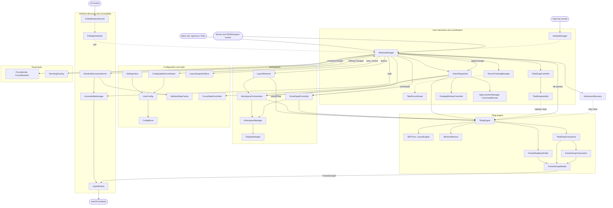

# HyprMac Architecture

HyprMac is a keyboard-driven tiling window manager for macOS. One
physical key acts as the "Hypr" modifier. It defaults to Caps Lock,
which HyprMac remaps to F18 at the IOKit driver level through
`hidutil`; every other choice is a key the event tap already sees.
Hotkeys feed into a thin orchestration layer that delegates to focused
subsystems for tiling, focus, workspaces, floating, drag, and
discovery.

`CLAUDE.md` holds the hard rules, the verify commands and the doc map.
This document is the structural narrative.

## Module layout

```
HyprMac/
├── App/                      lifecycle, settings shell, menu bar
├── Core/
│   ├── Chrome/               focus border and brackets, dim, drop preview, overlays
│   ├── Discovery/            AX bridge, discovery diff, AX observers, admission filter, drift
│   ├── Focus/                focus resolving and routing, window stack, floating windows
│   ├── Input/                hotkeys, Hypr remap, mouse tracking, verified tiled drags
│   ├── Orchestration/        action dispatch, polling, admission recovery, config routing, status export
│   ├── State/                window state cache, suppressions
│   ├── Workspace/            workspaces, displays, scratchpad, placement, layout restore
│   └── WindowManager.swift   wires everything together
├── Tiling/                   BSP trees, layout, frame readback
├── Models/                   windows, keybinds, actions, persisted config
├── Persistence/              config I/O, schema migration, layout snapshots
├── Settings/                 SwiftUI settings panes
├── Welcome/                  onboarding + what's new
├── Shared/                   logging, constants, design system, coordinate helpers, asserts
├── Resources/                bundled assets
└── PrivateAPI/               bridging header + CGS/SkyLight declarations
```

## Component map

A map for first reading. It shows the main types and how they connect, not every
call. `WindowManager` builds all of them, so most types also reach back to it
through closures. A solid line is a direct reference. A dashed line goes through
a closure or a callback that `WindowManager` wires up. `FrameSizingAttempt` reaches
windows through an injected `FrameSizingIO`, which the engine supplies.



Three paths to follow:

- **Hotkey:** `HotkeyManager` → `WindowManager` → `ActionDispatcher` → the service
  that owns the action. See "Hot path".
- **Discovery:** an app event reaches `PollingScheduler`, then
  `WindowManager.pollWindowChanges` walks the windows, `WindowDiscoveryService`
  computes the diff, and `ActionDispatcher.applyChanges` applies it.
- **Tiled drag:** `TiledDragHandler` runs the gesture through
  `TiledDragController` closures. `TiledDragTransaction` builds candidate trees and writes frames through
  `FrameSizingTransaction`, and `TilingEngine` publishes one only when it verifies. Nothing else changes a tree.

Update this map when wiring changes. Its edges were checked against the code at
`ff910c8`.

## Long-lived services

`WindowManager` constructs the dependency graph at app launch and
holds the only strong reference to most subsystems. The graph stays
live for the entire app lifetime. The process-wide singletons are
`UserConfig.shared`, `MenuBarState.shared`, `UpdateState.shared`,
`UpdateController.shared`, `LayoutSnapshotStore.shared` and
`DebugLogFile.shared`.

| Service | Responsibility |
|---|---|
| `WindowManager` | Orchestrator. Wires services, drives lifecycle, owns mouse monitors and observers, the display settle's timer, and the focus chrome refresh. |
| `HotkeyManager` | Session-level CGEventTap on a dedicated thread. Translates Hypr-key chords into `Action` values, dispatched to main. |
| `KeyRemapper` | hidutil-driven Caps Lock → F18 remap so the Hypr key produces clean keyDown/keyUp events. Adds and removes only its own `UserKeyMapping` entry (see "Caps Lock remap"). |
| `PhysicalKeyMonitor` | IOHIDManager read of the physical Caps Lock key, on the tap thread. Lets `HotkeyManager` ignore the F18 release macOS sends on Control up (see "Physical Caps Lock read"). Its keyboard access comes with Accessibility. |
| `AccessibilityManager` | AX bridge. Enumerates windows, resolves the focused window, picks directional neighbors. |
| `DisplayManager` | NSScreen tracking and CG ↔ NS coordinate conversion. |
| `ActionPolicy`, `ScratchpadActionRoute` | Pure gates a pressed action passes before `ActionDispatcher`. `WindowManager.handleAction` runs the effects. |
| `DisplaySettle` | Pure decisions behind the display-change debounce. `WindowManager` keeps the timer, suppressions and reconcile. |
| `FocusResolution` | Which window an action applies to, and what counts as selectable. |
| `FocusResolver` | Runs those queries against live state, and repairs focus on a bare Hypr press. |
| `WindowPlacement` | Classifies windows, distributes them across workspaces, and keeps hidden workspaces parked. |
| `WorkspaceStatusPresenter` | Read-only views of workspace state: menu bar, overview, status export, state dump. |
| `TiledDragController` | Capture and drop wiring for `TiledDragHandler`, the live drop preview, and what a finished drop owes. |
| `TiledDragFeedbackCoordinator` | Holds a degraded drop's error until a later layout settles it. |
| `FloatingDimDragTracker` | Keeps the dim's carve and the floater outline on a floater while it is dragged. `FloaterDragFollow` decides which of the two follow. Reads the floater's frame from the window list (`WindowStacking.bounds(of:)`), not from AX. |
| `DockAffordance` | What an outside app activation does when none of that app's windows are on screen. |
| `WorkspaceManager` | HyprMac's ten virtual workspaces, screen↔workspace mapping, home-screen affinity. |
| `TilingEngine` | One BSP tree per `(workspace, screen)`, verified sizing, smart insert, keyboard swap, and candidate drag commit. |
| `FloatingWindowController` | Float / tile toggle, cycle, raise-behind (with `RaiseBehindThrottle`), the click re-raise, auto-float predicate. |
| `MouseTrackingManager` | Focus-follows-mouse, refocus-under-cursor, menu and popup suppression. |
| `TiledFocusRouter` | Focus for hover, Hypr+Arrow, Hypr keydown and the focus invariant. Puts floaters an old tile covers back on top, then focuses and lifts the target. |
| `WindowStacking` | Rules over the CG window list: the frontmost app's open popup, pointer hit-test, floaters above or below a tile, the tiles covering each floater, and the rect-strip `subtract` that `FocusBorder` shares. Pure apart from `onScreen()` and `bounds(of:)`, which read the list. `bounds(of:)` returns one window's current frame. |
| `TiledDragHandler` | Owns captured press/release state, cancellation, and verified cache updates. |
| `LayoutTreeCodec` | A tree's shape to and from its saved form. Builds fresh nodes only. |
| `PassBudget` | The time one verified attempt's forward passes share. Rollbacks stay outside it. |
| `RollbackPlan` | Which windows a refused layout's rollback puts back. |
| `CrossScreenWriteOrder` | Whether a window crossing screens is sized before it moves, or moved first. |
| `NewcomerRefusal` | Which newcomers an admission retry leaves out. |
| `GeometryLedger` | The unverified and vacated marks on each tree's key. |
| `ParkAttempt` | Parks windows by position and checks they stay hidden. |
| `TiledDragTransaction` | Builds isolated insertion, swap, or resize candidates, within one tree or across two monitors' trees, and verifies frames before commit. |
| `TiledDragTargetResolver` | Finds the tile under a pointer, or the nearest tile for a release on another monitor, and the edge of it. `TiledDropPlanner` calls it. |
| `TiledDropPlanner` | Picks a tiled drop's target tile and edge. The drop and its live preview both call it, so they cannot disagree. |
| `TiledDragPreviewSession` | Throttles the live drop preview: at most 60 updates a second, the last move held, a redraw only when the landing rect changes. |
| `TiledDropPreviewPanel` | The click-through, floating-tier panel that draws the drop preview in the user's focus color. |
| `FrameSizingAttempt` | Bounded AX writes and complete frame readback through an injected clock and IO surface. |
| `FrameSizingTransaction` | A candidate attempt, then a rollback to the original frames when it fails, with one retry after an AX timeout when the caller asks. `TiledDragTransaction` uses it. |
| `AXFrameWriteBatch` | Brackets a window's frame writes: sets the app's AX messaging timeout and turns `AXEnhancedUserInterface` off for the writes, then restores it. |
| `FocusBorder` | Visual focus indicator. Persistent panels at `.floating` level with occlusion masking. Also owns one outline panel per visible floater, drawn in Corners and Window borders modes alike (`FloaterMarkStyle`: outline, or none in None mode). `WindowManager.refreshFloatingBorders` feeds it one floater set and one occlusion pass. |
| `FocusBrackets` | Corner brackets shown around the focus target while the Hypr key is held. They take the floating color on a floater (`FocusMarkColor`). `CornerMarkGeometry` builds the corner paths. |
| `DimmingOverlay` | Dim mask over non-focused tiled windows; one panel per display at `.floating - 1`. A floater's cutout covers only the part of it that is in front. |
| `CursorManager` | Cursor warp via `CGWarpMouseCursorPosition` + reassociate dance. |
| `AppLauncherManager` | Launch-or-focus path for the `launchApp` action. |
| `CommandRunner` | Runs the `runCommand` action's command line directly through `Process` — tokenize, resolve the program, launch. Never a shell. |
| `KeybindOverlayController` | HUD panel listing every active keybind (`Hypr+K`). |
| `ScratchpadController` | The scratchpad layer: windows on pseudo-workspace 0, parked until summoned. Separate `members` and `summonedIDs` sets. |
| `WorkspaceOverviewController` | The overview panel (`Hypr+O`), the workspace-switch HUD and the status HUD. |
| `ScreenshotPickerWatcher` | Says when macOS's screenshot picker is open, from the `screencaptureui` launch, or a fork of an app that runs `screencapture` itself (CleanShot), and the picker's overlay in the window list. The dim stays down until it closes. |
| `WindowCornerRadius` | The one global window corner radius for borders and dim cutouts. |
| `StatusExporter` | Off by default. Writes `state.json` and runs the optional hook (`docs/status-bar.md`). |
| `WindowAdmissionFilter` | Decides which AX windows discovery keeps (see "Quick Look previews"). |
| `DestroyRecheck` | Bounded re-poll after a destroy notification whose poll saw nothing gone: up to 2 more polls, 0.35 s apart. |
| `ExternalCommand` | Parses `hyprmac://` links (`docs/external-control.md`). `WindowManager.handleExternalURL` runs them. |
| `LoginItemController` | Launch at login through `SMAppService.mainApp`. |
| `SingleInstance` | Lets one copy run per user, release or Debug. A second copy quits in `HyprMacApp.init` (see "Single instance"). |
| `UpdateController` | Owns the Sparkle updater and is its delegate (see "Updates"). Not in the debug variant. |
| `UpdateState` | The pending-update notice the menu bar shows, plus `IdleInstallPolicy` and `UpdateWindows`. No Sparkle, so every variant builds it. |
| `RelaunchHandoffStore` | Owns `relaunch-handoff.json`: where every window was when an update quit HyprMac. Read once at the next launch. |
| `FrameReadbackPoller` | Runs candidate, adjusted and restoration passes over `FrameSizingAttempt` and classifies the readback into conflicts and min-size evidence. |

Tiled drags use `TiledDragHandler`. `ProbeFrame` is a Debug-only `--probe-frame` diagnostic.

## Orchestration layer (Core/Orchestration + Core/State + Core/Focus + Core/Discovery)

These types decompose what would otherwise be a monolithic
`WindowManager`. Each owns one concern and exposes a small surface:

- **`WindowStateCache`** holds the eight window-keyed stores that
  classify a window's lifecycle: `knownWindowIDs`,
  `floatingWindowIDs`, `originalFrames`, `windowOwners`,
  `hiddenWindowIDs`, `reservedHiddenWindowIDs`, `tiledPositions`,
  `cachedWindows`.
- **`FocusStateController`** owns the canonical "last focused" id and
  passes through the focus-border tracked id.
- **`SuppressionRegistry`** is a tiny date-gated key-value store for
  short-lived "don't react to X for Y seconds" flags
  (`activation-switch`, `mouse-focus`, `workspace-transition`). It also
  holds one-shot notes (`expectActivation`), so an app activation HyprMac
  caused is not read as the user's.
- **`PollingScheduler`** owns a slow (10s) reconcile timer plus a
  coalescing token that funnels event-driven `schedule(after:)` requests
  down to a single in-flight call. A request for an earlier fire moves
  that call up, so a hold's five-second expiry poll never delays an event
  poll. The timer is a safety net — it catches
  apps that refuse AX observers, notifications the observer layer missed,
  and external moves nothing else reports; `AXNotificationService` events
  are the primary trigger. WindowManager suppresses polling while the mouse
  is down, a tiled release is finishing, or a workspace transition is active.
  The drag finishing flag lasts through the deferred settle and verified
  transaction rather than expiring after a fixed timeout. A suppressed fire
  is deferred, not dropped: it asks again every 0.3 s, or at the end of the
  workspace transition when that comes sooner. A deferral that finds the
  press flag set with no button physically down twice, 0.25 s apart, clears
  the stale press (a missed mouse-up) so the poll can run.
  A window create asks for a *trailing* poll: when a poll is already due
  sooner, that one still runs and a second runs 0.2 s after the create,
  since the earlier one can land before AX lists the window. Each poll
  carries its triggers (`PollTrigger`) for the log lines. New-window work
  (`create`, `new-window`, `follow-up`, `focus`, `ax-retry`) also gets its own
  attempt at its deadline: under a finished workspace switch's hold it runs
  the admit-only pass instead of waiting (see "Suppression timing").
- **`DiscoveryFollowUp`** watches an app after a window create (or a focus
  or main-window event that showed an unseen window) until a poll admits a
  window of that app. A poll that misses asks for another at 0.3, 0.6 and
  1.2 s. The first retry after a create is blind; later ones need an
  on-screen layer-0 window of the app that discovery does not know. A
  focus or main-window event on an already known window polls only when the
  app has such a window that no poll has walked past yet, so a window
  discovery rejects costs one poll, not one per focus change.
- **`AXNotificationService`** owns one `AXObserver` per regular app and
  translates their AX notifications (window created / destroyed /
  miniaturized / deminiaturized, focused-window changed, main-window
  changed) into `schedule(after:)` calls on `PollingScheduler`. Apps
  report changes instead of being polled, so the discovery diff runs
  only when something changed. App-level subscriptions attach on
  `attachToRunningApps` / `attach(pid:)`; window-level ones attach lazily
  via `ensureWindowSubscriptions(for:)` after each discovery pass. Each
  refused registration is retried on its own on later polls, up to five
  tries, and running out logs at notice. Same
  architecture as yabai / AeroSpace.
- **`WindowDiscoveryService`** runs the diff between the previous and
  current AX snapshot. Owns the lifecycle/classification cache
  mutations on the discovery path; surfaces the rest in a
  `WindowChanges` value the dispatcher applies.
- **`WorkspaceOrchestrator`** sequences the workspace switch, the moves to a
  workspace or a monitor, the dedicated workspace transfer and a layout restore's batched
  moves, on top of `WorkspaceManager` and `TilingEngine`. It also makes the
  checks those moves need first, such as the count limit on a hidden
  destination.
- **`ActionDispatcher`** routes `Action` values to the services that
  handle them and runs the post-discovery apply-loop
  (`applyChanges`).
- **`AdmissionRecovery`** finishes newcomers a failed tile pass stranded:
  bounded retries, then a float in place. It also retries a key whose
  gap-filling pass failed on an AX error (`docs/tiling-algorithm.md`).
- **`MinimaRevalidation`** holds the markers for a learned minimum that a
  move to a hidden workspace will test on its reveal.
- **`TiledDriftMonitor`** re-applies a layout once when an app takes back a
  frame on the same screen. The poll drives it; it has no timer.
- **`ConfigUpdateCoordinator`** routes settings changes to layout or chrome.
- **`RetileAllPlanner`** and **`WorkspaceHomeResolver`** are pure rules for
  redistribution and for each workspace's home screen.

## Hot path

Hotkey trigger:

```
HotkeyManager.eventTap (CGEventTap, dedicated thread → dispatched to main)
  → WindowManager.performUserAction  (pause rule, toggleTiling)
  → WindowManager.handleAction       (display-settle drop, scratchpad rules, overview)
  → ActionDispatcher.dispatch
    ├ WorkspaceOrchestrator      (workspace switch / move)
    ├ FloatingWindowController   (toggle / cycle / raise)
    ├ ScratchpadController       (show / hide / send)
    ├ TilingEngine               (swap / split toggle / resize / retile)
    ├ AppLauncherManager         (launch / focus)
    └ CommandRunner              (runCommand)
        ↓
WindowStateCache and FocusStateController mutations
        ↓
TilingEngine.applyVerifiedLayout (verified passes via FrameReadbackPoller and FrameSizingAttempt)
        ↓
FocusBorder, FocusBrackets, DimmingOverlay (visual layer)
```

The menu bar calls `handleAction` directly, and `hyprmac://action` links call `performUserAction`.

Polling / discovery (parallel):

```
AXNotificationService (per-app AXObserver)     ┐
NSWorkspace notifications (launch/hide/…)       ├→ PollingScheduler.schedule(after:)
PollingScheduler.timer (10s reconcile net)     ┘        (coalesced)
  → WindowManager.pollWindowChanges
    → AccessibilityManager.getAllWindows
    → AXNotificationService.ensureWindowSubscriptions   (window-level subs)
    → WindowDiscoveryService.computeChanges
    → ActionDispatcher.applyChanges
    → TiledDriftMonitor (only when the poll did not retile)
    → WindowPlacement.repairParkedWindows
    → DiscoveryFollowUp.afterPoll  (re-poll an announced window still missing)

  under a finished workspace switch's hold, for new-window work only:
  → WindowManager.admitNewWindowsDuringHold
    → AccessibilityManager.getAllWindows
    → WindowDiscoveryService.computeAdmissions   (never-known ids only)
    → ActionDispatcher.applyAdmissions           (assign, retile, focus)
    → DiscoveryFollowUp.afterPoll
```

Per-app AXObserver notifications are the primary discovery trigger; the
10s timer only backstops missed events and observer-refusing apps.
A window the walk could not read — its app failed the window-list read,
or its frame read failed — is reported on
`AccessibilityManager.unreadableWindowIDs` while the window server still
shows it. Discovery holds such a window in every store: not gone, not
hidden, not returned. The tile pass keeps its leaf and writes no frame to
it, and the poll that reads it again retiles its key once. A later walk
that reads the window ends discovery's hold on it too, without waiting for
that poll (`AccessibilityManager.readWindowIDs`). A switch does not wait
for the poll at all, see "Reveal retry" below. The walk sets
a 0.25 s messaging timeout on the elements it reads, so a stalled app
costs a quarter second and is held rather than judged. An app whose
window list timed out is not asked again until a backoff is up, half a
second doubling to eight (`StallBackoff`), and only one stalled app is
asked per walk, the one asked longest ago, so a walk pays at most one
timeout however many apps are stalled and no app starves another. A walk
also has a 500 ms budget (`WalkPacing`): past it, only apps known to
answer fast are asked, and the rest are held and go first next walk. The
walk logs its duration and what it
skipped at debug (`AX walk:`). `AXWindowMatcher` pairs AX windows with
CG ids: an id the SPI names is used only when that window is on screen and
free, and never swapped for another when it is real; only an element whose
SPI failed falls back to the nearest on-screen window, within 64 points.
Nothing reports when a skipped app can be asked again or a window that
was not ready becomes ready, so `WindowDiscoveryService.secondsUntilARetryIsDue`
tells the poll when to run again: a backoff's end, a budget skip, a few
quick looks at a new window that was unbound or unreadable, and the
re-checks of a window floated for a fixed size, which goes back to tiling
if it turns resizable. A missing
window its app still lists, neither minimized nor hidden with the app —
another Space, a native full-screen excursion, a stale snapshot — is held
the same way for five seconds (`WindowDiscoveryService.listedHoldSpan`)
and hidden once it passes; a tile pass in between keeps its
leaf, so the excursion leaves the layout untouched, and the poll that
ends the hold is asked for when it runs out. `TilingEngine` owns the
hold: `heldWindowIDsSource` names the windows the walk could not hand
over, every pass asks it and holds the members its list does not carry,
so a retile, a move onto the workspace, a scratchpad show, the recovery's
passes and the drift re-apply all keep the held leaf, and no caller can
forget it. A pass given no list (a removal such as a send to the
scratchpad, a resize, a swap, a split toggle, a force insert) holds every
member of its tree the source names, so it neither reads a hung app's
window nor writes to one on another Space. A layout restore keeps a held
member of the live tree as an incumbent instead of dropping its leaf.
While the session is locked, the displays sleep, or the user session is
switched out, `computeChanges` treats a missing window as no evidence and
skips the cycle, and `pollWindowChanges` stops there;
`WindowManager.systemInterruption` opens and closes that span.

### Reveal retry

A switch reveals the incoming workspace from the walk it took first. An
app busy at that moment (a browser handling "back to tab" from picture in
picture, Messages activating from a Dock click) fails that walk, and its
windows stay in the hide corner: a floater has no handle to restore, and a
tile is held by the switch's tile pass. The poll that would repair them
waits out the 1.5 s transition hold and the app's stall backoff, which
left a tile parked for up to eight seconds.

`WorkspaceOrchestrator.retryReveal` asks just those apps again, every
100 ms for 15 tries, with a 50 ms timeout
(`AccessibilityManager.revealRetryWindows`). A tile joins when the engine
holds it on the incoming workspace (`TilingEngine.heldMembers`) and the
switch's walk could not read it, so a tile held as off on another Space
does not. When the app answers, its stall backoff ends
(`noteWindowListAnswered`). A floater gets its saved frame back. A tile
gets its frame from the engine: the retry walks again, and if the walk
reads the tile, releases the engine's hold record and retiles the visible
workspaces from that walk. The retry runs no drift detection and no park
repair, since frames read inside the transition hold are not settled. A
window moved, closed, hidden again or on a workspace another switch hid
leaves the retry, and a ghost never joins it. The switch asks for a repair
poll when it starts a retry (`onRevealMissed`), and again when the retry
gives up. `isSwitchSettled` stays false while a retry is pending. The
switch's focus pick is unchanged: a held tile does not take focus when it
comes back.

## Ownership rules

- **`WindowStateCache`** is the only owner of window-keyed
  classification / lifecycle dicts. Other services read it directly
  and mutate it through the cache.
- **`FocusStateController`** is the only place "last focus intent"
  lives. Every focus action records its result here.
- **`SuppressionRegistry`** owns date-gated suppressions and expected-activation notes only.
  Same-stack reentrancy guards (e.g.
  `FloatingWindowController.isRaising`) and in-flight coalescing
  tokens (e.g. `PollingScheduler.pendingPoll`) deliberately do not
  live here.
- **`TilingEngine`** owns the BSP trees. Nothing else mutates
  `tree.root`. Outside state reaches it through closures `WindowManager`
  wires: `heldWindowIDsSource` (the hold), `pendingRecoverySource` (the
  recovery's pending set) and `splitTargetSource` (the focus record, the
  tile a new window splits).
- **`WorkspaceManager`** owns the workspace↔screen mapping. Nothing
  else writes `monitorWorkspace`. Homes are not stored: they are computed
  through `WorkspaceHomeResolver`.
- **`FixedSizeHintStore`** owns `fixed-size-hints.json`, the per-app lengths windows
  kept. Per machine, not synced. Deleting it clears them.
- **`LayoutSnapshotStore`** owns `layout-snapshots.json`. It never
  sees a tree — `LayoutRestorer.capture` asks `TilingEngine.layoutTree`
  to serialise one and `WindowManager` hands the result across.

## Updates

Sparkle does the checking, downloading and installing. `UpdateController`
(`App/UpdateController.swift`) adds four things a menu bar window manager
needs. `Info.plist` turns automatic checks and automatic installs on for
a new install; a choice already stored in the user's defaults wins.

- **The updater's windows float.** Sparkle opens its windows at the
  normal level, and a scheduled check opens them without making HyprMac
  active. Among tiles that put the window behind the focused tile, and
  every later raise buried it further. `UpdateWindows` lifts each one to
  `Constants.interfaceWindowLevel`, the level Settings and the overlays
  use, and orders it front. That level is above every tile and floater
  and outside the two layers discovery reads.
- **Discovery never walks HyprMac itself**
  (`AccessibilityManager.isWalked`). With Show in Dock on HyprMac is a
  regular app, and a normal-level updater window would otherwise be
  tiled like any other.
- **A scheduled find is a notice, not a window.** HyprMac implements
  Sparkle's gentle reminders: `UpdateState.shared.notice` becomes
  `.available`, the menu bar item shows `MenuBarUpdateDot` (a bullet;
  a menu bar label takes one image and one line of text, nothing
  else), and the menu's update row opens the window. Sparkle still shows the window
  itself right after launch.
- **A downloaded update installs while the Mac is idle.** Sparkle
  normally waits for a quit, and a window manager is rarely quit.
  `updater(_:willInstallUpdateOnQuit:immediateInstallationBlock:)` keeps
  Sparkle's install block and sets the notice to `.ready`. A 30-second
  timer asks `IdleInstallPolicy`, and the menu row calls the same block.
  Quitting still installs, as before.

`IdleInstallPolicy` installs after five minutes with no keyboard or
pointer input, and only when the screen is unlocked, the display is
awake, no app holds a display-sleep assertion (a video, a call, slides,
or a keep-awake tool), and no native fullscreen window is in front. The
wait is under macOS's default ten-minute display sleep on purpose: a
launch behind a lock or a sleeping display gets a partial window list
from AX and would lay out only what it saw.

### Relaunch handoff

A normal launch spreads the open windows across workspaces from scratch.
After an update the user should find the desk as it was, so every
Sparkle relaunch (`updaterWillRelaunchApplication`) first calls
`WindowManager.saveRelaunchHandoff`. It writes `relaunch-handoff.json`:
each monitor's visible workspace, the focused window, every regular
workspace's tree, every floater with its workspace and frame, and the
scratchpad's members. Windows are saved by window id and owning pid.
The other apps keep running across HyprMac's relaunch, so the ids stay
valid, and they are exact where a layout snapshot's bundle id and title
are a best guess.

The next `start()` takes the file after its launch tile, whatever
`restoreLayoutOnLaunch` says, and deletes it. It is used only when it is
under ten minutes old and names the current display key. The restore
switches each monitor to its saved workspace, puts scratchpad members
back through `ScratchpadController.adoptPinned`, takes the floaters out
of the trees the launch tile put them in and moves them through
`WorkspaceOrchestrator.moveWindows`, then runs `LayoutRestorer` with
id-based refs for the tiled windows. A scratchpad member comes back by
the tile-by-default rule, not with its old slot.

Quitting still brings hidden workspaces' windows on screen first
(`restoreAllWindows`), so a relaunch that never comes back strands
nothing. The cost is a visible shuffle of a second or two at relaunch.

## Layout persistence

A snapshot covers every regular workspace on every monitor, keyed by
a fingerprint of the connected displays. Each workspace saves its BSP
shape — a `LayoutNode` (leaf, or split with override / ratio /
user-set flag) — plus `unplaced`: windows assigned to it that have not
joined its tree yet, such as one sent to a hidden workspace that has
not been shown since. Frames are not stored. Floaters, scratchpad
members and closed-but-alive windows are never saved. Titles are
stored with Terminal's trailing ` — 120×30` size dropped, since it
changes on every resize. Restore rearranges open windows only; it
never launches an app.

`Hypr+Ctrl+S` saves manually. The first `didChangeScreenParameters`
notification of a transition auto-saves under the departing key —
before macOS shuffles windows onto surviving screens and before the
trees migrate; later fires in the same debounce do not save again. An
automatic save never replaces a manual snapshot, and pruning evicts
automatic snapshots first.

`Hypr+Ctrl+R`, a settled reconcile whose display key differs from the
one it replaced, and the first start of the process (opt-in via
`restoreLayoutOnLaunch`; resuming from pause is not a launch) restore.
A settle under the same key (Dock resize, arrangement drag, primary
change) does not restore. Display keys are sorted `name:WxH` pairs, so
identical monitor models at the same size alias regardless of
arrangement. Both actions are dropped
while a display transition is settling. `LayoutRestorer`
(`Core/Workspace/LayoutRestorer.swift`) runs the restore and returns a
`LayoutRestoreOutcome`; `WindowManager` only looks up the snapshot,
refreshes the position cache, logs, and shows the HUD.

1. `LayoutMatcher` pairs saved leaves with live windows. Bundle ID is
   required. Exact non-empty title matches are reserved first across
   the whole snapshot, so a missing earlier leaf can't take a window a
   later leaf names exactly. Remaining leaves then take any unclaimed
   window of the same app, the one already on the leaf's workspace
   first. Every window is claimed once. Floaters and scratchpad
   members are never candidates.
2. `WorkspaceOrchestrator.moveWindows` applies the workspace moves.
   It uses the same suppressions and park/place steps as
   `Hypr+Shift+N`, but lays out and verifies each visible destination
   before any assignment changes, and drops windows from their source
   trees by membership only, with one retile at the end. A destination
   that refuses is laid out again with its old members, so its windows
   return to their tiles even when the arrival was parked. Each destination is judged on its projected
   membership once the whole batch lands, so two full workspaces can
   trade windows. A destination takes all of its arrivals or none;
   refusals (`full`, `wontFit`, `sizingRefused`, disabled monitors,
   scratchpad) come back per window.
3. `TilingEngine.rebuildTree` replaces each saved workspace's tree with
   the saved shape. Workspaces whose home monitor is disabled are
   skipped. A leaf whose window is gone collapses its split as a close
   would. Windows the snapshot never named smart-insert around the
   restored shape, incumbents first. A saved tree deeper than the
   screen's max depth is left alone. An already-admitted window that
   would find no slot rejects the rebuild and the live tree stays. A
   newcomer that finds none is left out; the restorer hands it to
   `AdmissionRecovery` the way a tile pass hands over its refused
   newcomers, so it floats in place instead of sitting untracked.
   Publishing removes the restored windows from any other screen's
   tree for the same workspace, so no window ends up in two trees.
   Visible workspaces go through the same verified sizing as any tile
   and publish only on acceptance. A hidden workspace's windows are
   parked, so its shape is published with the key marked unverified,
   and the accepted tile on its next show clears the mark.

The outcome is one of: no snapshot for this display setup, already in
place, complete, partial, or failed. Complete means every matched
window reached its saved workspace and every shape was rebuilt.
Partial means some of it applied and some was refused (a refused move,
a shape kept live, or a refused newcomer). Failed means something was
asked and none of it applied. Saved windows that are not open do not
make a restore partial; the log counts them, and the manual HUD
mentions them. A manual save or restore shows the workspace-switch
HUD (`WorkspaceOverviewController.showStatusHUD`) on the screen under
the cursor, with a title for each case and a short detail line.
Automatic restores are silent and
log the outcome at `.notice`. The Settings monitor toggle reuses the
reconcile under an unchanged key and does not restore.

The snapshot file keeps each tiled window's raw title, on this Mac
only. Deleting `layout-snapshots.json` (and any `.unreadable` copy)
while HyprMac is quit clears every snapshot.

## Suppression timing

`SuppressionRegistry` holds one expiry per `SuppressionKey`. A new suppression only ever extends it.

| Key | Delay | Set by |
|---|---|---|
| `mouseFocus` | 0.15 s | Keyboard actions, workspace switches, drags, floater raises |
| `activationSwitch` | 0.5 s | Programmatic focus and raises |
| `workspaceTransition` | 1.5 s | Workspace switches, moves, scratchpad changes |
| `workspaceTransition` | 3 s | Display notification, reconcile, the retile after a transition |
| `workspaceTransition` | 4 s | Sleep, wake, lock, unlock |
| `workspaceTransition` | 3 or 6 s | A display timer that waits again: the stability window plus 1 s |
| `workspaceTransition` | 6 s | A change within 20 s of a wake: `DisplaySettle.wakeSettleWindow` plus 1 s |

`workspaceTransition` holds every discovery poll: a poll mid-transition
reads windows at frames the switch or macOS has not settled yet, and screen
drift would move them to the wrong workspace. A poll deferred by it runs
10 ms after it ends, not on the next 0.3 s step.

A workspace switch's own hold lets brand-new windows in early. The switch
tags its suppression `source: .workspaceSwitch`; every other caller is
`.other`, and `SuppressionRegistry.isHeldOnlyByWorkspaceSwitch` is true
only while no `.other` hold is live. `SwitchHoldAdmission.allows` then also
needs `WorkspaceOrchestrator.isSwitchSettled` (no `switchWorkspace` call
under way, so its walk, retile and focus steps are done, and no reveal
retry still pending), no held button or finishing drag, no pending
display change and no session interruption. While all of that holds, a
new-window request runs `admitNewWindowsDuringHold` at its deadline instead
of waiting:

- `WindowDiscoveryService.computeAdmissions` takes only ids that are not
  known, not hidden (ghosts, minimized, Cmd-H'd), not unreadable and not
  on any workspace. Known windows the switch parked or revealed, gone and
  returning windows, drift and fixed-size re-checks are not looked at.
- The pass is skipped when a tiled member of a visible workspace is missing
  from the walk and not held: the retile would drop it from its tree, and
  whether it closed is the full poll's call.
- `ActionDispatcher.applyAdmissions` assigns the newcomer with the normal
  rules (the workspace now on its screen, or its window rule) and retiles
  the visible workspaces with the walk's known windows only, through the
  normal verified pass.
- The deferred poll still runs in full once the hold ends.

Moves, the scratchpad, display settle and wake keep holding new windows
until their hold ends. So does a move that follows its window, since the
move's own hold is `.other`.

## Threading

All window management runs on the main thread. `DebugLogFile` and
`StatusFilePublisher` write on their own serial queues and touch no window
state. The CGEventTap lives on its own dedicated thread (`HyprMac.EventTap`). It
is an *active* tap — macOS holds all system keyboard input until the
hosting run loop services the callback — so it must never share a run
loop with the synchronous AX work on main. The callback is O(1) chord
matching (mutable state guarded by a lock) and dispatches every action
to the main queue. `PhysicalKeyMonitor`'s IOHIDManager is scheduled on
the same run loop, so a busy main thread can't delay a Caps Lock release
either. Mouse monitors and `NSWorkspace` notifications
still fire on the main run loop. `FocusBorder`, `FocusBrackets`,
`DimmingOverlay`, `KeybindOverlayController`, `TiledDropPreviewPanel`,
`CursorManager`, `MouseTrackingManager` and `AXNotificationService` call
`mainThreadOnly()` on entry so an off-main caller crashes loudly in DEBUG.

There is no `async/await` in HyprMac today.

## Logging

Two-tier `os.Logger`-backed logging in `Shared/Log.swift`:

- **Trace** (`.debug` / `.info`) — developer-only, gated by build
  configuration. Emits in DEBUG by default; in Release only when the
  `HyprMacVerboseLogging` `UserDefault` is set, for support sessions.
- **Diagnostic** (`.notice` / `.warning` / `.error` / `.fault`) —
  always emits via `os.Logger`. Visible in Console.app filtered by
  subsystem and any of the categories in `LogCategory`. The subsystem is the
  bundle id: `com.zachgray.HyprMac`, or `com.zachgray.HyprMac.debug` for the
  Debug app.

Debug builds, and Release with `HyprMacVerboseLogging` set, also write every
line to `~/Library/Logs/HyprMac/` through `DebugLogFile`.

See `docs/debugging.md` for filter recipes and the verbose-logging
toggle.

## Workspaces

HyprMac maintains ten virtual workspaces in userspace. macOS native
Spaces are bypassed — use one native Space per monitor. Inactive
workspaces park their windows at a single global hide position: 1 px
inside the bottom-right corner of the **rightmost** monitor (a 1 px
sliver remains visible; macOS limitation). The rightmost edge has no
neighbor, so the parked window's off-screen extension never overlaps
another monitor and macOS's rescale-to-neighbor bug cannot fire. When
monitors share the rightmost edge, the lowest one holds the corner: a
monitor below it would catch the extension, and macOS would pull the
window onto it under its menu bar, shrunk to its height.

Every workspace is **statically anchored** to a home screen:
`enabledScreens[(N - 1) % enabledScreens.count]`, left to right.
Two screens on one x, a stacked desk, keep the order `NSScreen.screens`
lists them in, which puts the primary display first, so a stacked desk
keeps the homes it had. Retile All fills the screens in the same order.

The user can put workspaces on monitors by name (`workspaceMonitors` in
`monitor-config.json`, Settings → Layout → Workspaces). One pure function,
`WorkspaceHomeResolver.resolve`, decides every home from the enabled
screens and that mapping, and `WorkspaceManager.homeScreenForWorkspace` and
`workspacesAnchoredTo` are its only callers; every other consumer (the dedicated workspace move,
cycling, `initializeMonitors`, the overview, the menu bar, the switch HUD,
moves, window rules, layout restore, Retile All) goes through those two. A
workspace mapped to a connected, enabled monitor lives there. Every other
one, unmapped or mapped to a monitor that is missing or disabled, keeps its
formula home, so every workspace always has a home and an empty mapping is
the formula exactly. A number under two monitors goes to the name that
sorts first. Numbers outside 1–10 are ignored. Two displays that share a
name take the mapping on the leftmost of them. If the mapping would leave an
enabled monitor with no workspace, it is ignored for that layout and the
formula decides everything; Settings says so in one line. A mapping change
runs the same `reconcileAfterDisplayChange` as a monitor plug or unplug, so
trees move to their new homes and window membership never changes.
Switching to workspace N always lands on its home; workspaces cannot
move between monitors, so workspace identity never drifts. The
`moveWindowToMonitor` action (`Hypr+Ctrl+arrow`) moves the focused
*window* to the visible workspace of the nearest monitor in that
direction instead.

`Hypr+Shift+N` moves the focused window to workspace N and stays put,
unless N is showing on another monitor, where focus follows the window.
`Hypr+Ctrl+Shift+N` (`moveToWorkspaceAndFollow`) also switches to N with
the window focused. Both go through `WorkspaceOrchestrator.moveToWorkspace`,
and a follow warps the cursor to where the window is going rather than to
its live frame. See "Move and follow" in `docs/keybinds-and-actions.md`.

`WorkspaceOrchestrator.moveToNextEmptyWorkspace` implements the dedicated workspace move. It resolves
the actual AX-focused standard window and its physical display, then asks
`WorkspaceManager.nextEmptyWorkspace` for the next empty anchored workspace,
wrapping numerically. A floating window reserves a workspace. A hidden one
does not: closed-but-alive, minimized and Cmd-H'd windows keep their
assignment but hold no slot here. The source and any workspace showing on a
screen are never candidates.
A sole assigned window is already dedicated, so the action returns without moving it.
Workspace 10 belongs to the same anchoring formula; keyboard 0 selects it,
while internal workspace 0 remains the scratchpad.

The transfer captures source frames, verifies a private one-window candidate,
then verifies position-only source-window parking before publishing destination membership.
Parking accepts the macOS titlebar clamp when every physical display sees
at most the normal one-pixel right-edge sliver. A window taller than the corner
screen comes back cut to that screen's height. The next show retiles it.
A park counts as done after two hidden readbacks in a row that agree to one
point, so a window macOS is still moving does not pass between two steps.
Generation, display, and membership checks guard the commit. Ordinary failures
restore captured geometry through verified AX writes. Superseded or changed
display state must not receive stale-coordinate restoration. The mover is
never parked, and unrelated monitors are not retiled. Floating movers become
tiled and retain their captured floating frame for a later Toggle Float.
This fills the padded usable area without entering native macOS fullscreen.

The overview presents ten workspaces in two rows of five. Its window list
intersects assignment with fresh discovery, deliberate hidden reservations,
and unhidden known/cached windows. Verified-closed hidden entries are omitted
without deleting workspace reservations as a presentation side effect.

Monitor connect/disconnect runs `WindowManager.reconcileAfterDisplayChange`:
visible-workspace mapping refreshes (`initializeMonitors`), BSP trees
migrate to each workspace's current home
(`TilingEngine.handleDisplayChange`), hidden-workspace windows
re-park at the (possibly moved) global corner, and visible workspaces
retile. Each display remembers the workspace it last showed, by name, and
also by name and frame for two displays of one model. A display that
comes back shows that workspace again when it is still one of its own;
otherwise it falls back to its lowest home workspace. The fingerprint that
gates the reconcile is the sorted list of display names and frames plus
usable bounds. A display id that changes across a wake, or
`NSScreen.screens` in another order, is the same desk. When the desk
comes back with the fingerprint it had before the transition, the
visible workspaces still retile once, since macOS moved windows while a
display was away; over frames that already stand that pass only reads.

Within twenty seconds of a sleep, wake, lock or unlock the settle beat is
five seconds instead of two, since displays reattach one at a time. A
reconcile that comes due while the session is still locked or the
displays sleep waits and settles again; when the interruption ends, the
beat restarts from there. Polls are held off for the whole beat, every
time it is re-armed, and workspace and layout actions pressed meanwhile
are dropped with a beep. A park write that fails asks for the repair poll for the
first three failures in a row only; after that the ordinary poll retries.

Workspace assignments and the floating set are preserved across a display
change. Full redistribution (`distributeWindowsAcrossWorkspaces`) runs on
every `start()`, which includes resuming from pause, on a Max Splits change,
and on "Retile All". Discovery polling is
suppressed through the settle window so drift detection cannot
reassign windows from their OS-shuffled mid-transition positions.

See `docs/desktop-switching-notes.md` for why workspaces are virtual.

## Tiling

BSP dwindle layout. Each split picks the longer axis of the parent
rect by default; `togglesplit` overrides per-node. Smart insert
(`LayoutEngine.smartInsertFitting`) backtracks to shallower leaves when the
default deepest-right split would create slots below
`TilingConfig.minSlotDimension` (500 px), producing 2×2 grids on
constrained vertical monitors.

Max BSP depth is 3 by default (smallest slot = 1/8 of screen), and each
monitor can set 1 to 7 in Settings. Beyond that, smart
insert finds no fitting leaf. The pass reports the window as refused on its
`AdmissionResult`; nothing routes it elsewhere, and `AdmissionRecovery`
gives it one bounded retry and then floats it where it stands. A retry
refused on some of its newcomers floats only those and runs the pass again
for the rest, at most three times.

Layout runs in verified passes (`TilingEngine.applyVerifiedLayout`, through
`FrameReadbackPoller` and `FrameSizingAttempt`):
1. The candidate pass writes target frames and reads the complete layout back.
2. When that reveals a min-size conflict (Spotify, Messages, etc.),
   `BSPTree.adjustForMinSizes` moves an ancestor's split ratio
   to give the constrained app more room (clamped to
   `[TilingConfig.minRatio, TilingConfig.maxRatio]`), and an adjusted pass
   re-applies and verifies again.
3. Only an accepted pass publishes. Anything else restores the original frames.

`MinSizeMemory` records observed minimums so subsequent layout
decisions know which apps cannot shrink. Min sizes lower only when
the app accepts a tighter resize by at least
`lowerMinSizeAcceptedDeltaPx` (10 px) — sub-pixel accepts cannot
ratchet the floor down.

See `docs/tiling-algorithm.md` for the full algorithm walkthrough.

## Quick Look previews

A Quick Look preview (select a file, press Space) is a `QLPreviewPanel`.
It is one long-lived panel inside whichever app opened it (Finder,
Messages, Mail), not a window of a Quick Look process.

`WindowAdmissionFilter` (`Core/Discovery`) is the one place that decides
which AX windows discovery keeps. It admits a Quick Look panel when all
of these hold:

- role `AXWindow` and subrole exactly `Quick Look`. That is what the panel
  reported on macOS 15.7. Its role description (`window`), identifier,
  title and document are generic or empty, so the subrole is the only
  Quick Look signal;
- not modal, and not in native full screen (`AXFullScreen`);
- its own CG window, found through `_AXUIElementGetWindow` and never by
  position, is visible on layer 0 or layer 3. The panel sits at the
  floating level (layer 3) while its app is active.

An admitted panel is always a floater (`FloatingAdmissionPolicy` reason
`quick look preview`) and never enters a BSP tree:

- **Opening** is a new floating window, assigned to the visible workspace
  on the screen where it opened. Floaters use no tile slot, so a full
  workspace does not route it anywhere. Startup and Retile All ask the same
  policy, so they keep it floating too.
- **Floating logic** treats it like any floater: Hypr+Shift+T cycles to it,
  and raise-behind lifts it when a tile covers it. While its app is active
  it sits on layer 3, above every tile, so nothing covers it then.
- **Hypr+T** does not tile it. The toggle refuses up front with the red
  shake ("Quick Look previews stay floating") and nothing is laid out.
  Sending it to the scratchpad beeps, and moving it off a disabled monitor
  keeps it floating.
- **Arrowing to another file** resizes the panel to fit the item. That is
  left alone: floaters get no drift re-apply.
- **Closing** (Space, Esc, the close button) orders the panel out. The app
  stops listing it, and the next preview comes back with the same id.
  Discovery forgets it outright, floating flag and all, instead of keeping
  a ghost, so the next preview is new. The same happens if it disappears
  for any other reason: its app hidden or deactivated, or Quick Look's own
  full-screen view.
- **Full screen** is never managed. Native full screen is refused by the
  rule. Quick Look's own full-screen view sets the panel's alpha to 0 and
  draws on higher layers, so the panel leaves the snapshot until it
  returns.

macOS 27 behaviour is unconfirmed. `docs/debugging.md` lists the log lines
that show what the panel reports there.

## Coordinate systems

CG (CoreGraphics) uses a top-left origin; NS (AppKit) uses
bottom-left. Conversion anchors on the primary screen height:

```
ns_y = primaryScreenHeight - cg_y - height
cg_y = primaryScreenHeight - ns_y - height
```

`DisplayManager.primaryScreenHeight` is cached and refreshed on
`didChangeScreenParameters`. Every visible-tile / mouse-coordinate
calculation routes through it.

See `docs/coordinate-systems.md` for the multi-monitor edge cases
and the monitor identity contract (user-facing config keys by
`localizedName`; internal state keys by `displayID`).

## Persistence

`UserConfig` (the `@Published` SwiftUI-observable surface) →
`ConfigStore` (raw I/O + iCloud sync) → JSON on disk at
`~/Library/Application Support/HyprMac/config.json`.

Config safety, all in `ConfigStore`:

| Situation | What happens |
|---|---|
| File missing | Defaults. Normal on a first run |
| File unreadable (truncated, garbage, wrong type in a core field) | Log a `.warning` with the reason, never the values. At launch use defaults; while running keep current settings. The file is left alone, since a read mid sync can look unreadable |
| Any save over a file that exists but won't open | Skip the save and log a `.warning`, so nothing replaces bytes HyprMac could not copy. iCloud setup and repair stop the same way |
| Any save over a file that doesn't decode | Copy it to `<name>.unreadable` first, for `config.json` and `monitor-config.json`. If the copy fails, the save is skipped |
| Any save | Atomic, written to the real file behind a symlink so the iCloud link survives. A failure is logged with its error code and the old file stays |
| Any save to a file or folder HyprMac can't write | Skipped. `access(W_OK)` on the resolved file and its folder, so a 0444 file in a writable folder isn't renamed over. Settings shows a read-only notice |
| Something that isn't a regular file at the path (a pipe) | Unreadable, checked with one `stat` before the read, so launch can't block on it |
| A file iCloud hasn't downloaded (`SF_DATALESS`) | Not read on the main thread. It counts as unreadable, so a link to it holds saves. A background read brings it down, and owners reload when it lands |
| A link or linked folder another tool made (Nix, Stow, chezmoi) | Saves go through it if it's writable. The iCloud switch never replaces or moves it, and turns back off, at launch or when the watcher sees the path change |
| Launch finds a link it can't read | Hold `config.json` saves so defaults never reach other Macs. A good file arriving ends the hold, and so does turning sync off or on. `monitor-config.json` still saves. A file lost while running isn't held, because memory holds real settings |
| Launch finds a regular file where the iCloud link belongs | Copy it to `config.json.replaced` if it differs, link, then reload before anything can save |
| Enable sync over a readable iCloud file | When the two differ, Settings asks which to keep. iCloud's: the launch-repair path, so the local file goes to `config.json.replaced`, the path links to iCloud, and the shared settings load. This Mac's: the upload path below. Launch repair never asks; iCloud wins |
| Enable sync that sets nothing up (an iCloud copy not downloaded, a write that fails) | The switch and its preference go back off |
| Enable sync over an iCloud file that doesn't decode, or choosing this Mac's settings | The local file goes up. The bad iCloud file is copied to `config.json.replaced` first, and the local file goes only after iCloud holds its data |
| Toggle sync on a private file | The mode carries across, so a 0600 file stays 0600 in iCloud and back |
| Reset all settings | One update. The button has no confirmation, so both files are copied to `<name>.replaced` first |

Copies live beside the local path and never sync. Each takes the mode of the
file it copies, so a 0600 file gives a 0600 copy. An older copy is never
overwritten: new bytes get `.2`, `.3` and so on, and the same bytes aren't
copied twice. Nothing reads or prunes them. They are there for a person.

The watcher covers both files. Off the main queue it checks every 2 s which
entry, folder and file each path reaches (`FileMark`: device, inode, size,
mtime, ctime), and holds the reached file open for events so an edit in place
shows at once. Main compares each mark with the one taken at the last read or
save, so only outside changes reload, and a change made while stopped shows at
the next start. A re-pointed Home Manager link, a swapped folder and a file
that appears late all show up this way. A save of `config.json` still reports
once, because the reload that follows a save is existing behavior: it re-merges
default keybinds and pins the bracket length.

Known limits: on macOS 13, an evicted iCloud file is a `.config.json.icloud`
placeholder that nothing here asks to download, so that link stays held and
launch repair treats iCloud as empty. A hold is only in the log, with nothing in
Settings. Unknown keybinds a newer build wrote are still dropped on save.

`ConfigMigration` handles one-time data migrations and schema
versioning: the monitor-config split (per-machine `maxSplitsPerMonitor`
and `disabledMonitors` moved out of the synced config into
`monitor-config.json`), the bracket color split from the border color, and
the toggle-floating and focus-floating keybind moves.

`ConfigUpdateCoordinator` observes one post-mutation signal from `UserConfig`
and compares complete snapshots against the initial configuration. Disk reloads
emit after all properties have been stored. Geometry and monitor changes route
to layout callbacks; appearance changes route only to chrome updates. This
avoids first-reload retiles, stale `@Published` reads, and duplicate listeners
after restart. Hover response and focus-follows-mouse are read on each mouse
event and need no update callback. See [settings polish](settings-polish.md).

The on-disk JSON wire format for keybinds is frozen — see
`docs/keybinds-and-actions.md` for the contract.

## Caps Lock remap

`hidutil`'s `UserKeyMapping` is one system-wide list. Users with their
own system-wide mappings (from a LaunchAgent or a script) share it with
HyprMac, so
`KeyRemapper` never writes the whole list from scratch. It reads the list
through IOKit (`IOHIDEventSystemClientCopyProperty`), changes only its own
Caps Lock → F18 entry, and writes the result with `hidutil property --set`.
The rules are the pure `KeyMappingMerge`, pinned by `KeyRemapperTests`:

- Install adds the entry once. Every other entry keeps its place.
  Repeated launches never add a second copy, and a list that already
  matches is not written.
- Remove (at quit, when the Hypr key changes away from Caps Lock, and
  at launch when it is not Caps Lock) takes out only that entry. It never
  writes `[]` over other entries.
- A user entry whose source is Caps Lock (Caps Lock → Escape, say)
  cannot coexist with ours. While Caps Lock is the Hypr key, ours takes
  its place in the list, and the user's entry is held in the
  `heldCapsLockKeyMappings` default. The hold is stored before the write
  and cleared only after a successful one. Remove puts it back where ours
  was. If something else has mapped Caps Lock by then, or ours is already
  gone, the hold is dropped instead. Taking over, putting back and
  dropping each log at `.notice`.
- A list with an entry HyprMac can't reproduce exactly (not a plain
  src/dst pair of whole numbers) is left alone. Nothing is written, and
  the skip logs at `.error`. With Caps Lock as the Hypr key, that leaves
  the Hypr key dead until the list is fixed.
- An entry identical to ours counts as ours, whoever added it.

It reads through IOKit instead of parsing `hidutil property --get`: the
key is public (`kIOHIDUserKeyUsageMapKey`), the value comes back typed, and
the `--get` output is a CoreFoundation description string with no stable
format. A missing property (nothing set since boot) reads as an empty
list. If that read ever came back empty while our entry was set, remove
would write nothing and leave F18 in place.

The Debug and Release apps have separate defaults domains, so each holds
its own displaced entry. Running one after the other while an entry is
held can put back a mapping the user no longer has. Quit one variant
before starting the other.

Mappings set per keyboard with `hidutil --matching` are not in this list,
and HyprMac does not read or change them.

## Physical Caps Lock read

With Caps Lock as the Hypr key, letting go of Control while Caps Lock is
still held makes macOS send an F18 keyUp in the same millisecond (#81). It
looks exactly like a real release: same event source fields, and the HID
system state also says F18 is up. No second keyUp comes on the real
release. The event tap can't tell them apart, so Hypr used to end early and
the next arrow went through as a plain arrow.

`PhysicalKeyMonitor` reads the key itself. It opens every keyboard through
`IOHIDManager` without seizing it, with input values matched to Caps Lock
only (page 7, usage 0x39), so no other key reaches HyprMac. The pure
`PhysicalKeyHoldState` tracks which keyboards hold it: held on two, one up,
still held; the holding keyboard unplugged counts as released.
`HotkeyManager` takes the reader through `PhysicalCapsLockReading`, so tests
drive it with a fake.

- An F18 keyUp while Caps Lock is physically held is ignored. The physical
  up then ends Hypr. On a normal press the physical up lands 1–5 ms before
  the F18 keyUp, so presses end on time.
- The monitor runs only while Caps Lock is the Hypr key, the tap is
  running, and `IOHIDCheckAccess(kIOHIDRequestTypeListenEvent)` says
  granted. `refreshPhysicalKeyMonitor` decides, on start, on a Hypr key
  change and on each 5 s health-check tick. Anything else means no
  keyboard is opened and the tap behaves as before.
- Reading a keyboard needs ListenEvent access, the one System Settings
  lists as Input Monitoring. macOS grants it to an app that has
  Accessibility, so HyprMac never asks for it and shows no UI for it.
  Confirmed on macOS 27.2.1 with the Debug app: after
  `tccutil reset ListenEvent`, with no Input Monitoring entry at all, the
  check said granted and `IOHIDManagerOpen` succeeded. Accessibility off
  made the check say denied; back on, granted again and the monitor
  started. HyprMac never calls `IOHIDRequestAccess`.
- If the open fails, it logs once per error code and the tap keeps the
  old behavior. The health check retries quietly.
- Missed ups can't leave Hypr stuck for long: a tap interruption, sleep,
  wake, lock or unlock resets the held state; a keyboard removal releases
  its hold; revoked access (Accessibility turned off) stops the monitor
  and ends a press whose F18 release was ignored. If an up is missed
  anyway, the next Caps Lock press ends it.

## Single instance

Two copies of HyprMac must never run together. Each has its own event tap
and tiling engine, so they move the same windows against each other, and
the first to quit takes the Hypr key remap away from the other. That holds
for the release beside the Debug app too: they are the same window manager
under two bundle ids.

macOS does not prevent it. LaunchServices folds a second launch into the
running app only when the launch goes through it and names the same bundle
path. Then the running app gets a reopen, which shows Settings. These all
start a second process instead:

- a launchd agent that runs `Contents/MacOS/HyprMac` directly, as the Home
  Manager module's does (`docs/nix.md`), while a login item or a hand
  launch has already started the app
- a copy at another path with the same bundle id
- the Debug app (`com.zachgray.HyprMac.debug`) beside the release
- `open -n`, or the binary run from a shell

`LSMultipleInstancesProhibited` does not stop a directly run binary, so
`Info.plist` does not set it.

`SingleInstance.claimOrExit()` is the first thing `HyprMacApp.init` does,
before Sparkle, the menu bar item or `AppDelegate` exist. It takes an
exclusive, non-blocking `flock` on
`~/Library/Application Support/HyprMac/instance.lock` and keeps the
descriptor open for the life of the process. Every build uses that one
file. Both apps are unsandboxed, so both resolve the same folder.

The holder writes `<bundle id> <pid>` into the file. The text is only a
label; the lock is the `flock`. A copy that can't get the lock reads the
label, logs one `.notice` under `lifecycle` and calls `exit(0)`:

```
HyprMac is already running (com.zachgray.HyprMac, pid 4321); this copy (com.zachgray.HyprMac.debug) is quitting
```

Nothing is shown, and the running copy is not told. A Debug build also
writes the line to the file log.

| Case | What happens |
|---|---|
| Two copies start at the same moment (a login item and a launchd agent at login) | The kernel gives the lock to one. No start times or pids are compared |
| The old copy is still quitting (a quit followed at once by a reopen) | The new copy retries every 0.1 s for up to 3 s (`quitGrace`), then takes over. Sparkle starts the new version only after the old process is gone, so an update does not normally wait at all |
| The holder crashed or was killed | The kernel freed the lock with the process. There is no stale lock and nothing to clean up |
| A launchd agent started the second copy | Exit code 0 is a successful exit, so `KeepAlive = { SuccessfulExit = false; }` does not start it again |
| The Debug app beside the release | They share the lock, so whichever started first runs and the other quits. To switch, quit the running copy first (`docs/laptop-debug-deployment.md`) |
| Both are login items | The kernel picks one at login. Keep "Launch at login" on in one of them only |
| An XCTest host (any `XCTest…` environment variable) | Not guarded and no lock taken, so hosted tests run while any HyprMac is open, and a HyprMac can start while they run. The isolated harness never runs `HyprMacApp.init` |
| `--check-accessibility`, `--request-accessibility`, `--check-input-monitoring` (Debug app), `--preview-overlays`, `--probe-frame` (`DEBUG` builds) | Not guarded and no lock taken. They answer and quit without starting the window manager, and are meant to run beside it. A new one-shot flag must be added to `SingleInstance.isOneShotDiagnostic` |
| The lock file can't be opened or locked (a read-only folder, a file system without `flock`) | The copy runs unguarded and logs a `.notice`. A broken lock must never keep HyprMac from starting |
| A command HyprMac starts (`runCommand`, the status hook, `hidutil`) | The descriptor is opened `O_CLOEXEC`, so a child can't inherit the lock and hold it after HyprMac quits |

The lock is per user, since the folder is in the home directory. Two users
on one Mac each run their own copy.

## Permissions

- **Accessibility** (System Settings → Privacy → Accessibility) —
  required for AX queries and CGEventTap.
  `AppDelegate.applicationDidFinishLaunching` checks it. Without it, the
  non-modal permissions gate (`App/PermissionsGate.swift`) opens and polls
  once a second, and a grant starts HyprMac with no relaunch.
  Accessibility also covers the physical Caps Lock read above: macOS
  treats an app with Accessibility as having Input Monitoring, so there is
  no second permission to grant.
- **Caps Lock set to "⇪ Caps Lock"** in System Settings → Keyboard →
  Keyboard Shortcuts… → Modifier Keys — that pane applies in the HID
  event system, before the `hidutil` user mapping and before any
  CGEvent exists, so "No Action" (or any other choice) swallows the key
  before `KeyRemapper` or the event tap sees it. It is per keyboard.
  The same holds for Option and Command on either side, and for
  Control, which older configs may still use (see "Hypr key" in
  `docs/keybinds-and-actions.md`). Shift, Tab, backtick, backslash and
  F13–F20 are not in that pane. macOS exposes no supported way to read or change this,
  so HyprMac never claims it is verified: `HyprKeySystemGuidance`
  supplies the copy and the deep link shown in the permissions gate,
  the tour, and Settings → Keys.

HyprMac runs without disabling SIP, but is not App Store compatible —
it uses private SkyLight APIs (`_SLPSSetFrontProcessWithOptions`,
`SLPSPostEventRecordTo`, and the `SLSWindowQuery…` calls behind
`DeclaredSizeLimits`, which only feed logs), a private AX API
(`_AXUIElementGetWindow`), and runs `hidutil` as a process. The public API replacements do not exist.
Only the standalone `tools/space-test.swift` probe calls the CGS Space functions.

## Known limitations

These are documented in detail in their respective `docs/` files;
this list is the index.

- **1 px hide-corner sliver** — hidden workspace windows leave a
  one-pixel visible corner. macOS limitation.
- **Floating windows can sit behind tiled windows** — without SIP
  disabled, HyprMac cannot reliably set another process's window
  level. `Hypr+Shift+T` cycles and raises floaters, and `raiseBehind` runs
  on app activation and after discovery. It raises only floaters a tile
  overlaps, stands down while the frontmost app has a menu open, and cools a
  pair down when a raise does nothing. The focused window sits above a floater
  wherever they overlap, and a floater is on top of every other tile. See
  `docs/debugging.md` "Floaters and open menus".
- **A visible move's rollback can degrade** — if a restoration write or its
  readback fails, `applyVerifiedLayoutAttempt` returns `.degraded` and the
  window can stay on the destination screen while it is assigned to the
  source. The next poll reads it as drift and completes the move the user saw
  refused. No recovery owns the failed restoration; admission recovery acts only
  if the drift retile fails.
- **Two-axis ratio adjustment can flip a split's axis** — when a window needs
  more than its slot in width and height, and a split on the way up has no
  pinned axis, the width pass can turn that split and leave the height pass
  nothing to adjust. Smart insert pins the axis, but a turn or a move to a
  screen of the other orientation drops the automatic pins
  (`BSPTree.dropAutomaticSplitOverrides`). `HyprMacTests/BSPTreeTests.swift`
  skips this case.
- **Squishy-sibling swap rejection** — when a swap squishes a
  sibling app that has no AX-reported or readback-confirmed minimum
  size (the canonical case in the user's setup is Sidenote), the
  mathematical layout fits and the swap accepts even though the
  resulting compression may look wrong. See
  `docs/tiling-algorithm.md` "Known limitations".
- **Two physical monitors with identical localized names cannot be
  configured separately** — user-facing per-monitor config keys by
  `localizedName`. See `docs/coordinate-systems.md` for the contract.

## Known cleanup

These are not bugs:

- **Code with no production caller:** `BSPTree.compact`, `BSPTree.smartInsert`
  and `RetileAllPlanner.pack`. Only tests call them.
- **Forgetting a window is split in two** —
  `WindowStateCache.forget(_:)` clears cache state and
  `applyForgottenIDExternalCleanup(_:)` runs the engine / workspace
  / focus side. Intentional: the discovery apply-loop calls them
  separately so it can clear cache state for a batch in one pass
  and run external cleanup per id.

## Where to look next

- `CLAUDE.md` — hard rules, verify commands, doc map.
- `docs/tiling-algorithm.md` — BSP algorithm, smart insert, two-pass
  layout, min-size memory.
- `docs/coordinate-systems.md` — CG ↔ NS, multi-monitor edge cases,
  monitor identity contract.
- `docs/keybinds-and-actions.md` — `Action` enum, Codable contract,
  frozen JSON case keys.
- `docs/debugging.md` — Console.app filters, verbose-logging toggle.
- `docs/desktop-switching-notes.md` — why workspaces are virtual.
- `docs/testing.md` — test harness traps, headless runs, Release build.
- `docs/status-bar.md` — `state.json`, hook, status links.
- `docs/external-control.md` — `hyprmac://action` links.
